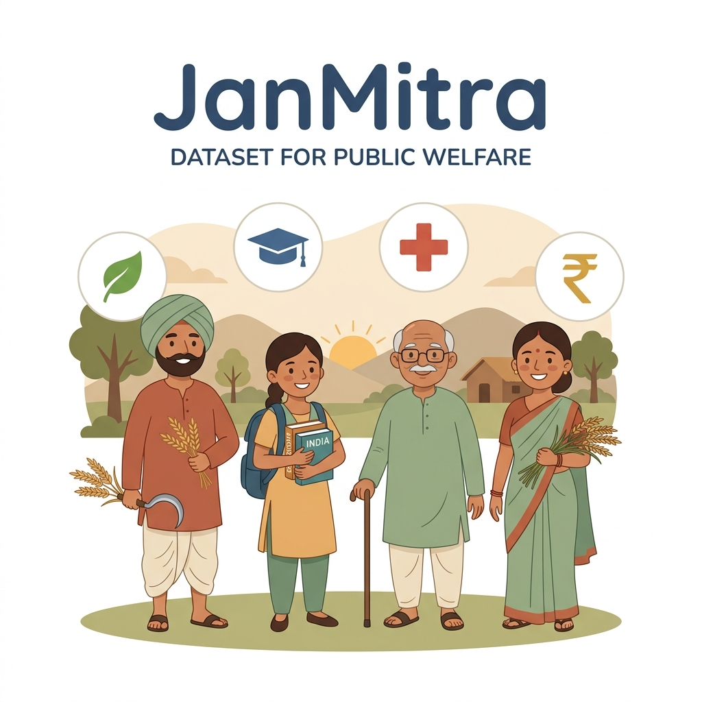

# JanMitra Dataset: Multi-lingual Conversational and Recommendation Dataset for Government Scheme Assistants



## 1. Overview
The **JanMitra Dataset** is a comprehensive, multi-faceted synthetic dataset designed to support research, training, and evaluation of conversational AI assistants, recommendation engines, and NLP systems tailored for public welfare and government scheme access. 

This dataset supports **JanMitra: AI-Powered Government Scheme Assistant**, a system aimed at helping citizens discover eligible government welfare schemes through natural, multilingual voice and text conversations.

---

## 2. Dataset Structure & Directory Layout

The dataset is divided into three key directories, each targeting a specific sub-task in the JanMitra system:

```text
dataset/
├── README.md                      # Dataset Documentation (this file)
├── metadata.json                  # IEEE DataPort upload metadata
├── schemes/
│   ├── government_schemes.csv     # Details and eligibility schemas of schemes
│   └── government_schemes.json    # Nested JSON version of schemes
├── citizen_profiles/
│   ├── citizen_profiles.csv       # Citizen profile features and eligibility labels
│   └── citizen_profiles.json      # Nested JSON version of citizen profiles
└── conversational_nlp/
    ├── intent_entity_queries.csv  # User query strings with intent & entity labels
    └── intent_entity_queries.json # JSON version of queries
```

---

## 3. Data Dictionary

### 3.1. Government Schemes (`dataset/schemes/`)
Contains information on 15 prominent Indian government welfare schemes (e.g., PM-KISAN, Ayushman Bharat PM-JAY, Sukanya Samriddhi Yojana, Stand-Up India, etc.) across various categories like Agriculture, Health, Social Welfare, Education, and Financial Inclusion.

| Column Name | Data Type | Description |
| :--- | :--- | :--- |
| `scheme_id` | String | Unique identifier for the scheme (e.g., `SCH_001`, `SCH_002`) |
| `scheme_name` | String | Official name of the government scheme |
| `ministry` | String | Respective central/state government ministry handling the scheme |
| `category` | String | Classification domain (e.g., Agriculture, Health, Education) |
| `description` | String | Brief overview of the scheme's goals and implementation |
| `eligibility_min_age` | Integer | Minimum age limit for eligibility (0 if no minimum age) |
| `eligibility_max_age` | Integer | Maximum age limit for eligibility (120 if no maximum age) |
| `eligibility_gender` | String | Gender restriction: `All`, `Male`, `Female` |
| `eligibility_max_income`| Integer | Maximum annual family income in INR allowed for eligibility |
| `eligibility_occupation`| String | Target occupations (e.g., `Farmer`, `Daily Wage Worker`, `Street Vendor`, `All`) |
| `eligibility_caste` | String | Caste target restrictions (SC, ST, OBC, or All) |
| `eligibility_disabled` | String | Disability status requirement (`True`, `False`, or `All`) |
| `benefits` | String | Details of financial, service, or physical subsidies provided |
| `documents_required` | String | Comma-separated list of required documents (e.g., Aadhaar, Land records) |
| `application_mode` | String | How citizens apply: `Online`, `Offline`, or `Both` |

---

### 3.2. Citizen Profiles & Recommendations (`dataset/citizen_profiles/`)
Contains 10,000 synthetic citizen profiles representing various demographic groups in India (diverse ages, incomes, occupations, castes, and states). Programmatic rules based on the official scheme criteria are applied to generate ground-truth labels for scheme eligibility.

| Column Name | Data Type | Description |
| :--- | :--- | :--- |
| `citizen_id` | String | Unique identifier for the citizen (e.g., `CIT_0001` to `CIT_10000`) |
| `age` | Integer | Age of the citizen (5 to 85 years) |
| `gender` | String | Gender: `Male`, `Female`, `Other` |
| `occupation` | String | Occupation: `Farmer`, `Student`, `Unemployed`, `Street Vendor`, `Daily Wage Worker`, etc. |
| `annual_income` | Integer | Annual income in INR (correlated to occupation) |
| `caste` | String | Caste category: `General`, `OBC`, `SC`, `ST` |
| `disabled` | Boolean | Disability status (`True` or `False`) |
| `state` | String | State of residence (e.g., Andhra Pradesh, Telangana, Uttar Pradesh, etc.) |
| `area_type` | String | Resident environment: `Rural` or `Urban` |
| `eligible_schemes` | String | Semicolon-separated list of eligible `scheme_id` keys based on programmatic check |

---

### 3.3. Conversational NLP (`dataset/conversational_nlp/`)
Contains 6,000 unique conversational user queries (1,000 per language) representing user interactions with the assistant. Languages include **English, Hindi, Telugu, Tamil, Kannada, and Bengali**. Each query is annotated with intent labels and named entities.

| Column Name | Data Type | Description |
| :--- | :--- | :--- |
| `query_id` | String | Unique identifier for the query (e.g., `QRY_0001` to `QRY_6000`) |
| `query_text` | String | The query string (e.g., "Am I eligible for PM Kisan?") |
| `language` | String | Language of the query (`English`, `Hindi`, `Telugu`, `Tamil`, `Kannada`, `Bengali`) |
| `intent` | String | The labeled intent: `check_eligibility`, `scheme_inquiry`, `how_to_apply`, `document_requirements`, `list_schemes_by_category`, `greet` |
| `entities` | JSON String | Extracted entities with values (e.g., `{"scheme_name": "...", "scheme_id": "...", "state": "..."}`) |

---

## 4. Methodology
1. **Schemes Compiling**: Exact criteria for 15 primary welfare schemes of the government of India were formalised into conditional logic rules.
2. **Citizen Synthesis**: Citizen demographics were sampled from realistic distributions (e.g. correlating lower age to "Student", agricultural states to rural "Farmer" occupations, and restricting income ranges logically based on professions).
3. **Label Assignment**: Demographics were programmatically verified against the scheme rule engine to produce exact, mathematically sound `eligible_schemes` lists.
4. **NLP Synthesizer**: Templates for user intents were constructed in English and then translated/localized into regional Indian languages by native experts. These templates were populated with sampled attributes (e.g., state names, occupations, income levels) and scheme names to create a rich, realistic corpus for NLU.

---

## 5. Potential Research Applications
- **Recommendation Systems**: Evaluating collaborative filtering, content-based matching, and deep classification networks for mapping citizen attributes to eligible public welfare.
- **Multilingual Intent Classification**: Training intent classifiers (e.g. BERT, XLM-RoBERTa, Llama-LoRA) to process mixed-script and multilingual regional languages.
- **Named Entity Recognition (NER)**: Identifying scheme aliases, locations, age, and occupation indicators from chat inputs.
- **RAG Verification**: A benchmark for Retrieval-Augmented Generation evaluation, measuring chatbot hallucination rates on complex, rule-based policies.
